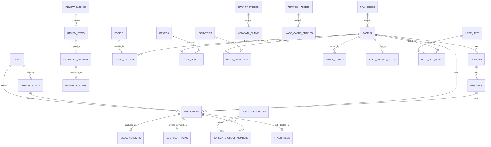

# ESTIRAHA NEXT — DATABASE SCHEMA & RELATIONSHIPS (`DATABASE_SCHEMA.md`)

## 1. Core Database Principles
- **Engine:** Local SQLite 3 (`WAL` journal mode, `PRAGMA foreign_keys = ON`, `synchronous = NORMAL`, `busy_timeout = 10000ms`).
- **Immutable Primary Keys:** Every work (`works.id`), person (`people.id`), season (`seasons.id`), episode (`episodes.id`), and physical file (`media_files.id`) uses an immutable UUIDv7 string PK. Renaming a file or moving it across folders/disks updates `disk_id` / `relative_path` while preserving `media_files.id`, watch history, ratings, and review audit trails.
- **Separate Title Columns:** `title_original`, `title_ar`, and `title_en` are stored in distinct columns—never speculatively translated.
- **Pre-Migration Safety Backup:** Before any new schema migration runs on an existing database, `internal/db` writes a `SHA-256` checksummed `.db.bak` backup.

## 2. Complete Table Inventory (33 Relational Tables + 2 FTS5 Virtual Tables)

### A. Storage & Topology
1. `schema_migrations` — Applied migration versions, filenames, and SHA-256 checksums.
2. `disks` — Physical/logical drives (`volume_serial`, `volume_guid`, `mount_path`, `total_bytes`, `free_bytes`, `connection_state`).
3. `library_roots` — Monitored root folders per disk (`content_category`, `scan_enabled`, `watch_enabled`).

### B. Media Works, Hierarchy & Classifications
4. `countries` — ISO country codes with Arabic & English names.
5. `genres` — Genre taxonomy with Arabic & English names.
6. `franchises` — Cinematic franchises (`canonical_folder_name` strictly without year).
7. `works` — Master catalog for all 12 media types (`media_type`, `sub_format`, `title_original`, `title_ar`, `title_en`, `production_year`, `canonical_folder_name`, `identification_status`, `franchise_id`).
8. `work_countries` — Many-to-many `works <-> countries`.
9. `work_genres` — Many-to-many `works <-> genres`.
10. `seasons` — Series/Program/Doc-Series seasons (`season_number`, `canonical_folder_code` e.g. `S01`, `expected_episode_count`).
11. `episodes` — Episodes (`episode_number`, `canonical_file_stem` e.g. `01`, `is_missing` for gap detection).
12. `collections` — User & smart thematic collections.
13. `collection_items` — Works linked to collections.

### C. Celebrities / People
14. `people` — Celebrities (`name_ar`, `name_en`, `name_original`, `canonical_display_name` as `الاسم بالعربية (English Name)`).
15. `work_credits` — Virtual non-duplicating link between `works` and `people` (`actor`, `director`, `writer`, `host`, etc.).

### D. Physical Files, Versions, Duplicates & Subtitles
16. `media_files` — Every discovered file (`video`, `subtitle`, `image`, `nfo`, `shorts`, `archive_zip`, `archive_rar`, `unknown_extra`), `size_bytes`, `partial_fingerprint`, `sha256_hash`, `nesting_depth`, `archive_entries_json`, `integrity_status`, `presence_status`, `keep_decision`.
17. `media_versions` — Technical video/audio stream analysis (`width`, `height`, `resolution_label`, `video_codec`, `hdr_format`, `bitrate_kbps`, `audio_codec`, `audio_channels`, `computed_quality_score`, `is_preferred_auto`, `is_preferred_manual`, `version_role`).
18. `duplicate_groups` — Exact SHA-256 duplicate clusters and multi-version work/episode clusters.
19. `duplicate_group_members` — Member files per duplicate cluster with reason & proposed action.
20. `subtitle_tracks` — External (`srt`, `ass`, `ssa`, `vtt`) & embedded subtitle tracks, matched video link, `sync_offset_ms`, `is_redundant_extra`.

### E. API Hub, Claims & Smart Image Engine
21. `data_providers` — Provider registry (`integration_status`, `priority_rank`, `rate_limit_per_minute`, `credential_manager_target`, `require_per_request_consent`, `terms_reviewed`, `attribution_requirement`).
22. `metadata_claims` — Field-level provenance (`entity_type`, `entity_id`, `provider_id`, `field_name`, `claimed_value_json`, `confidence_score`, `has_conflict`).
23. `provider_http_cache` — Expiring raw response cache respecting provider TTL rules.
24. `artwork_assets` — Validated `JPEG`/`PNG`/`WebP` metadata (`origin_type`, `is_protected_user_asset`, `is_primary`, `is_redundant_extra`).
25. `image_cache_entries` — Disk LRU index (`cache_tier`, `cache_rel_path`, `byte_size`, `access_count`, `last_accessed_at`, `pinned_offline`).

### F. Hybrid Watch Management, Ratings & Lists
26. `watch_states` — Hybrid (`auto_player` / `manual`) watch status (`unwatched`, `watching`, `watched`, `watch_later`, `rewatching`), `resume_position_ms`, preferred version/subtitle/audio, `last_watched_episode_id`.
27. `playback_history` — Session log across internal `mpv` or external `VLC`.
28. `user_ratings_notes` — Personal rating (`0.0`–`10.0`), personal notes, favorite flag.
29. `user_lists` — Multiple user-defined favorite/watchlists.
30. `user_list_items` — Works/episodes inside user lists.

### G. Review Center, Crash-Safe Journal, Rollback, Trash, Backups & System
31. `review_batches` — Organization/cleanup preview batches (`draft_preview`, `awaiting_approval`, `approved`, `halted_on_interrupt`, `rolled_back`).
32. `review_items` — Individual old-vs-proposed path/name diffs with user edits and `decision_status` (`pending`, `approved`, `excluded`, `rejected`, `deferred`, `executed`).
33. `operation_journal` — Stepwise execution journal with `pre_sha256`, `post_sha256`, and `last_successful_substep` for power-loss recovery.
34. `rollback_steps` — Ordered reverse operations (`move_back`, `rename_back`, `restore_from_trash`).
35. `trash_items` — Internal soft-deleted items with origin path and manual-only purge tracking.
36. `audit_logs` — Immutable security/safety/filesystem event log.
37. `backup_records` — Verified backup archives (`sha256_checksum`, `schema_version`, `portable_manifest_json`).
38. `app_settings` — Application & customizable dashboard layout preferences.
39. `notifications` — Bilingual AR/EN user alerts.
40. `background_jobs` — Checkpointed resumable jobs (`checkpoint_cursor_json`).

### H. FTS5 Virtual Search Indexes
41. `works_fts` — Synchronized via triggers (`INSERT`/`UPDATE`/`DELETE`) on `works` using `unicode61 remove_diacritics 2` (supports Arabic diacritic-insensitive search + English).
42. `people_fts` — Synchronized via triggers on `people`.

## 3. Entity Relationship Diagram (Mermaid)

